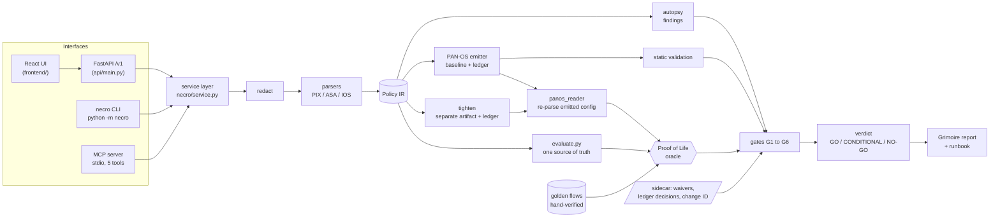
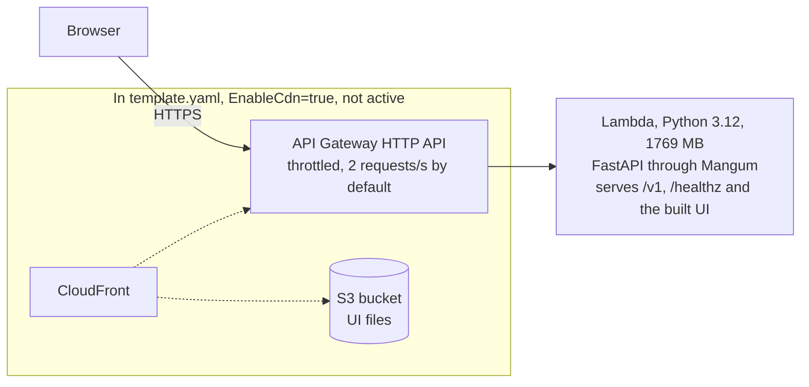

# NECROMANCER

**Raise dead firewall configs as zero-trust policy, and prove they came back the same.**

[](https://github.com/natrajexplore/necromancer/actions/workflows/ci.yml)
[](LICENSE)


*Kiroween 2026, category **Resurrection**.*

1. NECROMANCER reads an end-of-life Cisco PIX, ASA or IOS config and emits a like-for-like Palo Alto PAN-OS candidate config.
2. A property-based oracle then checks that the old and the new policy decide every generated packet the same way, or shows the single smallest packet that does not.
3. Six validation gates turn the evidence into a GO, CONDITIONAL or NO-GO verdict and a report a change advisory board can review.

## Live demo

**https://7bs6otuwci.execute-api.ap-southeast-2.amazonaws.com** (no login, no API keys, synthetic configs only)

The engine and the UI both run in one AWS Lambda behind an API Gateway HTTP API. The first request after a quiet
period includes a Lambda cold start and can be slower.

### 60-second judge walkthrough

Open the demo and use the bundled sample `pix-2006-hq`:

1. **Exhume.** Click the `pix-2006-hq` tombstone. It reads as Cisco PIX 6.3(5), detection confidence 0.95, coverage 100%.
2. **Autopsy.** Open step 2. 21 findings. `AUT-0008` is critical: telnet permitted from an outside network to the web server (rule `outside_in#5`).
3. **Resurrect.** Open step 3 and click **Resurrect**. Under "Zero-trust tightening" click **Accept AUT-0008**, type an approver name, and click **Prove the tightened artifact**. This builds a second PAN-OS config, separate from the baseline, with its own ledger and proof.
4. **Proof of Life.** Open step 4 and click **Prove**. All 16 hand-verified golden flows pass. Tick **Haunt it** and click **Prove** again: the proof fails and shows *the packet that refused to rest*, the smallest packet on which the deliberately broken candidate differs from the source.
5. **Verdict.** Open step 5 and click **Run the gates** (about 13 seconds on the live demo). The baseline is **NO-GO**: ledger entry `LED-0001` is pending (G5) and `AUT-0008` is an open critical finding (G6). Choose **tightened (1 accepted)**, enter an approver name and a reason for `LED-0001`, click **Accept LED-0001**, then **Run the gates again**. The tightened artifact is **GO**. The report and both configs download from the same page.

The baseline verdict never changes because of the tightening. Both verdicts are in the report, and the tightened one is
marked as a separate change.

The deployed build is the one `/healthz` reports (commit `509b3a6` when this was written). The latest commits are in this
repository and are not deployed yet.

## What is built

| Part | State |
|---|---|
| Engine (`backend/necro`) | Built. Parsers for PIX 6.x, ASA 7.x to 8.2 and IOS 12.x. Evaluator, autopsy, PAN-OS emitter, exorcism ledger, tightening, Proof of Life oracle, gates G1 to G6, Grimoire report, runbook |
| Interfaces | Built. `necro` CLI, FastAPI `/v1` API, and an MCP server with five tools (`exhume`, `autopsy`, `resurrect`, `prove`, `gate`) |
| UI (`frontend/`) | Built. React graveyard UI with the five screens of the ritual |
| Hosted demo | Live on AWS (API Gateway HTTP API + Lambda). The CloudFront and S3 mode in `template.yaml` is available and not active |
| Tests | Built. Backend, property-based, golden-flow, mutation, frontend unit, Playwright end-to-end and axe. Numbers are in [Tests and quality](#tests-and-quality) |
| Not built (Phase 2) | ASA 8.3 and later, PAN-OS NAT rule emission, hit-count import, PDF and CSV export. See [Supported scope](#supported-scope) and the [roadmap](#roadmap) |

Every number in this README, with the command that produced it, is in [`docs/evidence.md`](docs/evidence.md).

## Contents

- [The problem](#the-problem)
- [The ritual](#the-ritual)
- [Architecture](#architecture)
- [Migration semantics it gets right](#migration-semantics-it-gets-right)
- [Proof, not promises](#proof-not-promises)
- [Readiness verdict and governance](#readiness-verdict-and-governance)
- [Tests and quality](#tests-and-quality)
- [Supported scope](#supported-scope)
- [Built with Kiro](#built-with-kiro)
- [Quick start](#quick-start)
- [Repository map](#repository-map)
- [Roadmap](#roadmap)
- [Security and data notice](#security-and-data-notice)
- [Contributing](#contributing)
- [Disclosure](#disclosure)
- [License](#license)

## The problem

Every enterprise has a graveyard: Cisco PIX, ASA 8.x and IOS 12 devices that went end-of-life years ago but still guard
production. They stay because nobody can prove that a rewrite of thousands of rules behaves the same. Manual migrations
quietly break things: a security-level permit nobody wrote down, an ACL that referenced a NATed address, an ICMP rule
widened to "ping", an IPv6 line that simply vanished.

NECROMANCER turns that leap of faith into evidence a change advisory board can review.

## The ritual

| Step | What happens |
|---|---|
| Exhume | Parse the config into a vendor-neutral IR. Secrets are redacted first, and every input line is classified, so nothing disappears silently |
| Autopsy | Find ghost rules: shadowed, redundant, overly broad, insecure services, unused objects, insecure management, unfiltered interfaces |
| Resurrect | Emit a like-for-like PAN-OS candidate config. Optional zero-trust tightening is a **separate** output, tracked in an exorcism ledger |
| Proof of Life | A property-based oracle (Hypothesis) checks old against new decisions over boundary-biased flows, plus hand-verified golden flows, or shows the shrunk counterexample |
| Verdict | Gates G1 to G6 give GO, CONDITIONAL or NO-GO, with the blocking reasons first |
| Grimoire | A deterministic, audit-stamped report and a cutover and rollback runbook for the change record |

## Architecture

All three interfaces call one service layer, so limits, errors and results are the same everywhere.



### AWS deployment, as it is today



The stack runs in the `EnableCdn=false` mode (`deploy.ps1 -NoCdn`): the UI files ship inside the Lambda package and the
same function serves the UI and the API on one origin. The CloudFront and S3 mode is defined in `template.yaml` and
described in [`DEPLOY.md`](DEPLOY.md). It is not deployed. Nothing is persisted: uploads are processed in memory.

## Migration semantics it gets right

The classic ASA and IOS to PAN-OS traps are pinned down in
[`policy-semantics.md`](.kiro/steering/policy-semantics.md) and tested with hand-verified vectors in
[`samples/golden-flows/`](samples/golden-flows).

| Trap | What NECROMANCER does |
|---|---|
| ASA and PIX interface without an ACL | Models the security-level implicit permit (higher to lower only), the same-security restriction and PIX `nat-control` |
| Pre-8.3 NAT | ACLs use the mapped address. The PAN-OS rule keeps that pre-NAT address and takes the destination zone from the real address |
| Destination zones | Derived from the route table (longest prefix). A rule that spans several zones is split, one PAN-OS rule per zone |
| IOS `established` | PAN-OS is stateful and has no equivalent, so the rule is omitted and recorded in the ledger as `stateful-established` |
| IOS interface without an ACL | Permits everything, and is flagged as an unfiltered interface |
| Traffic to the device itself | Becomes a PAN-OS interface management profile, not a security rule. The evaluator models it from the `telnet`, `ssh`, `http`, `icmp` and `snmp-server` commands |
| Port names | Keyed by protocol: 514/tcp (`rsh`) is not 514/udp (`syslog`), and Cisco `radius` is 1645 |
| ICMP types | Exact types through custom applications. Never silently widened to the `ping` App-ID |
| Like for like | `application any` plus explicit service objects. Never `application-default` in the baseline |
| IPv6, FQDN objects, transparent mode and similar | Become security-relevant unparsed lines that **block** the verdict until a named person waives them |

**Worked example.** `pix-2006-hq` rule `outside_in#5` permits telnet from `203.0.113.0/24` to the web server. The
baseline keeps it exactly: `set rulebase security rules outside_in-5 ... application any`, `service tcp-23`,
`action allow`. Accepting `AUT-0008` removes it in the tightened artifact and records ledger entry `TGT-0001`, class
`tightening`, `permit` to `deny`, affecting `tcp 203.0.113.0/24 -> 192.168.50.10/32 dport 23`. Tightening only removes
access: ssh is named as the better service and is not granted.

## Proof, not promises

- **Equivalence oracle.** Hypothesis generates boundary-biased flows (port edges, mask edges, every named ICMP type,
  NAT and device addresses) per interface context. The emitted PAN-OS text is parsed back and its decisions are
  compared with the source decisions, action and destination zone. The only allowed differences are the ones listed in
  the ledger. Budgets: `dev` 500, `ci` 5,000, `demo` 10,000 examples per context.
- **Shrunk counterexamples.** When the policies diverge, you get the smallest packet that shows it, with both
  decisions, matching rules and zones.
- **Golden flows.** 58 expected decisions written by hand from vendor semantics, independent of the evaluator. 42 are
  active (PIX 6.x, ASA 8.2, IOS 12). The 16 for ASA 9.8 are skipped until Phase 2.
- **Mutation suite.** 10 deliberate emitter bugs (`lt` and `gt` swapped, `neq` emitted as `eq`, ICMP echo-reply widened
  to `ping`, an untranslated 8.3+ destination, and others). The oracle must fail on each one, and it does (27 tests).
- **Properties.** 94 property-based tests, run at 5,000 examples each in the CI profile. 11 of the 14 playbook
  properties in [`pbt-playbook.md`](.kiro/steering/pbt-playbook.md) have tests. P4 (reordering disjoint rules), P5
  (object-group expansion is idempotent) and P13 (ASA 8.3+ NAT mapping, Phase 2) do not yet.
- **On the sample.** `necro prove ... pix-2006-hq.cfg --profile demo` checks 30,712 flows across 3 contexts, plus the
  16 golden flows, in about 5 seconds.

## Readiness verdict and governance

| Gate | Blocks GO when |
|---|---|
| **G1** Input integrity | Dialect confidence is below 0.9, the OS version is unsupported, or the mode is not routed single-context |
| **G2** Coverage | Any security-relevant line is unparsed or out of scope and not waived |
| **G3** Target static validation | Invalid or duplicate names, unresolved references, empty groups, missing zones or final deny, an unledgered `any` to `any` allow |
| **G4** Equivalence | The proof ran below the `ci` budget, any divergence is outside the ledger, or any golden flow fails |
| **G5** Ledger review | Any ledger entry is still pending, or a rejected entry is still applied |
| **G6** Risk findings | Any open critical finding without an accepted-risk record |

- **GO**: all gates pass. **CONDITIONAL**: passes only through valid, named, unexpired waivers, or the four-eyes rule is
  not met. **NO-GO**: anything else.
- The tightened artifact gets its own verdict. G4 uses its own proof, and G6 re-runs the autopsy on the tightened
  policy, so a critical finding counts as cleared only when the emitted artifact no longer has it.
- A haunted candidate (the demo's deliberately broken one) is refused by `gate` and `grimoire`.
- The runbook lists PAN-OS `test security-policy-match` and ASA `packet-tracer` commands with the expected result for
  each. The report maps its evidence to PCI DSS v4.0, NIST SP 800-41 and 800-53, ISO/IEC 27001:2022 and CIS Controls
  v8 as "supports evidence for". It never says "compliant" or "safe to deploy".
- The 12 migration phases are defined in [`migration-governance.md`](.kiro/steering/migration-governance.md).

## Tests and quality

Measured on 2026-11-27 at commit `7eb6f08`. Commands and raw output: [`docs/evidence.md`](docs/evidence.md).

| Area | Result |
|---|---|
| Backend tests | 2240 passed, 1 skipped (the Phase 2 ASA 9.8 golden test), plus 6 performance tests run separately |
| Backend coverage | 98.63% of `necro/` (CI gate: 90%) |
| Static checks | `ruff` clean, `mypy --strict` clean on 82 source files |
| Property-based tests | 94, all passing at the `ci` budget (5,000 examples each) |
| Golden flows | 58 hand-verified, 42 active, 16 Phase 2 |
| Mutation suite | 10 mutants, all caught |
| Frontend unit tests | 124 passed in 12 files |
| End to end | 9 Playwright tests in Chromium against the real engine: the full ritual, the haunted path, 3 axe runs (no rule disabled), keyboard and reduced motion |
| Lighthouse (desktop, production build) | Performance 100, accessibility 100, best practices 100, SEO 100 ([details](docs/a11y-lighthouse.md)) |
| Dependency audits | `pip-audit`: no known vulnerabilities. `npm audit --audit-level=high`: 0 vulnerabilities |
| CI jobs | 4 in [`ci.yml`](.github/workflows/ci.yml): repo integrity, backend, frontend, end to end |

## Supported scope

| Source | Version | Phase |
|---|---|---|
| Cisco PIX | 6.x | Phase 1, built |
| Cisco ASA | 7.x to 8.2 (pre-8.3 NAT) | Phase 1, built |
| Cisco IOS | 12.x standard and extended ACLs | Phase 1, built |
| Cisco ASA | 8.3 to 9.x (object NAT, global ACL, `any4`) | **Phase 2, not built.** The `asa-9.8-dc` sample exists for it, its 16 golden flows are skipped, and gate G1 fails for these versions by design |
| Target | Palo Alto Networks PAN-OS, candidate `set` commands | Phase 1 built. NAT rule emission is Phase 2 |

Out of scope for policy migration (detected and listed, never silently dropped): VPN, dynamic routing, AAA, IPS, QoS,
multiple-context mode, transparent mode, identity firewall and TrustSec. Time-range schedule objects and PDF and CSV
export are Phase 2.

NECROMANCER never connects to a device. It writes a candidate config for people to review and load themselves.

## Built with Kiro

The application was built with **Kiro CLI**, spec first. Counts below come from the repository
([`docs/evidence.md`](docs/evidence.md)).

| Kiro feature | Use in this project |
|---|---|
| Specs | 3 specs ([`necro-engine`](.kiro/specs/necro-engine), [`migration-governance`](.kiro/specs/migration-governance), [`graveyard-ui`](.kiro/specs/graveyard-ui)) with 126 acceptance criteria. 59 of 66 task boxes are ticked: necro-engine 40 of 46, migration-governance 10 of 11, graveyard-ui 9 of 9. The open ones are Phase 2 work and two optional stretch tasks. 53 of the 91 commits carry a `kiro-task` trailer |
| Steering | 8 documents in 3 inclusion modes: always (product, tech, structure, security), fileMatch (policy-semantics, migration-governance, haunted-ui) and manual (pbt-playbook) |
| Hooks | 6: proof of life on save, ghost-rule guard, readiness-gate guard, secret exorcist before writes, spec traceability, and a journal entry at the end of each session (42 entries in [`docs/kiro-journal.md`](docs/kiro-journal.md)) |
| Custom agents | 5 with scoped tools: `ghoul-parser`, `autopsy-surgeon`, `necromancer`, `oracle`, `gatekeeper`. The journal records `gatekeeper` in two sessions. The others are defined but not recorded as used |
| MCP | The project's own server (`backend/mcp_server.py`, five tools) registered in `.kiro/settings/mcp.json`, plus `fetch` |
| Property-based testing | Properties and the mutation suite were written in Kiro sessions and are run by a hook and by CI |

Not claimed: Kiro Crew (the [`crew/`](crew/README.md) folder is a design, not a working crew), Kiro IDE, Kiro Web,
Powers, or a vibe-coded comparison spike. How Kiro was used, with examples and corrections, is in
[`docs/04-kiro-usage-writeup.md`](docs/04-kiro-usage-writeup.md).

## Quick start

Requires Python 3.12, [`uv`](https://docs.astral.sh/uv/) and Node 22 or later.

**Windows (PowerShell).** With Windows Smart App Control on, use the signed python.org Python 3.12 and run tools as
modules. Details are in [`tech.md`](.kiro/steering/tech.md).

```powershell
cd backend
$env:UV_PYTHON_PREFERENCE = 'only-system'
uv sync --locked
uv run python -m pytest -q -m "not perf"                               # backend tests
uv run python -m necro gate ..\samples\dead-configs\pix-2006-hq.cfg    # NO-GO, with the reasons
uv run python -m uvicorn api.main:app --port 8000                      # the API, in one terminal

cd ..\frontend                                                         # the UI, in another terminal
npm.cmd ci
npm.cmd run dev                                                        # http://localhost:5173
```

**Linux and macOS.**

```bash
cd backend
uv sync --locked
uv run pytest -q -m "not perf"
uv run necro gate ../samples/dead-configs/pix-2006-hq.cfg       # exit code 1 means NO-GO
uv run python -m uvicorn api.main:app --port 8000               # the API, in one terminal

cd ../frontend                                                  # the UI, in another terminal
npm ci
npm run dev                                                     # http://localhost:5173
```

Other commands, from `backend/` unless noted:

| Command | Does |
|---|---|
| `uv run python -m necro exhume\|autopsy\|resurrect\|prove\|gate\|grimoire <file>` | The CLI. `--format json\|md\|text\|html`, `--profile dev\|ci\|demo`, `--sidecar FILE`, `--tightening FILE` |
| `uv run python -m mcp_server` | The MCP server on stdio (already registered in `.kiro/settings/mcp.json`) |
| `npm run e2e:install` then `npm run e2e` (in `frontend/`) | Playwright and axe against the real engine and UI |
| `python -I .github/scripts/check_repo.py` (repository root) | Specs, hooks, samples and golden-flow checks |
| `python -I .github/scripts/check_docs.py` (repository root) | Encoding, link and heading checks for the documentation |

To deploy to your own AWS account, see [`DEPLOY.md`](DEPLOY.md).

## Repository map

```
.kiro/specs/            necro-engine, migration-governance, graveyard-ui (requirements, design, tasks)
.kiro/steering/         product, tech, structure, security, policy-semantics, migration-governance, haunted-ui, pbt-playbook
.kiro/hooks/            6 hooks
.kiro/agents/           5 custom agents and their prompts
.kiro/settings/         mcp.json
backend/necro/          engine: parsers, IR, evaluator, autopsy, emitters, tighten, oracle, gates, report, runbook, CLI
backend/api/            FastAPI app and the Lambda handler
backend/mcp_server.py   MCP server
backend/tests/          pytest and Hypothesis tests
frontend/               React UI, unit tests, Playwright specs (e2e/)
samples/dead-configs/   4 synthetic configs with seeded "! GHOST:" rules
samples/broken-configs/ 4 negative fixtures
samples/golden-flows/   58 hand-verified expected decisions (TOML)
template.yaml           AWS SAM template, deploy.ps1 deploys it
crew/                   a Kiro Crew design (not built)
docs/                   evidence, accessibility notes, planning documents, Kiro write-up, video script, Devpost draft
.github/                CI workflow and repository checks
```

## Roadmap

- [x] Specs, steering, hooks, custom agents and MCP configuration
- [x] Synthetic samples, negative fixtures and 58 golden flows
- [x] necro-engine Phase 1: IR, PIX, ASA 7.x to 8.2 and IOS parsers, evaluator, autopsy, PAN-OS emitter, tightening, Proof of Life, CLI, API and MCP server
- [x] migration-governance Phase 1: gates G1 to G6, verdict, audit header, Grimoire, runbook
- [x] graveyard-ui: graveyard, autopsy, resurrection, proof, verdict, accessibility pass, Playwright and axe tests
- [x] Hosted demo (API Gateway HTTP API and Lambda)
- [x] Separate verdict for the tightened artifact
- [ ] Redeploy the demo from the latest commit
- [ ] Deploy the CloudFront and S3 mode (`EnableCdn=true`, blocked until the AWS account is verified)
- [ ] Phase 2: ASA 8.3 to 9.x (object NAT, global ACL), PAN-OS NAT rule emission, time-range schedule objects
- [ ] Phase 2: hit-count import, PDF and CSV export
- [ ] Property tests for P4, P5 and P13
- [ ] Stretch: TrustSec SGACL emitter, a Check Point parser, a working Kiro Crew

The original plan is in [`docs/03-build-plan.md`](docs/03-build-plan.md).

## Security and data notice

- All sample configs are **synthetic**: RFC 5737 and RFC 1918 addresses and fake secrets. CI fails if a non-synthetic
  address appears in `samples/`.
- Secrets (enable and user passwords, pre-shared keys, SNMP communities, TACACS and RADIUS keys) are redacted before
  anything else runs. The report recommends rotating each one, counted by type and never shown.
- The hosted demo processes uploads in memory and stores nothing. Use synthetic configs only on the public demo.
- Limits: 2 MB upload, 10 s parse timeout, at most 20,000 oracle examples per request, 10 POSTs a minute per client in
  each warm Lambda instance, and an API-wide throttle (2 requests a second by default).
- NECROMANCER **never connects to or pushes configuration to any device**. It produces a candidate config and evidence
  for human review.
- Vendor names describe compatibility only. This project is not affiliated with or endorsed by any vendor.

## Contributing

Wrong migration decisions are the most valuable reports. See [CONTRIBUTING.md](CONTRIBUTING.md) for the ground rules
(synthetic data only, spec first, nothing silent) and use the **Migration semantics** issue form. Everyone taking part
follows the [Code of Conduct](CODE_OF_CONDUCT.md). Report vulnerabilities privately through
[security advisories](https://github.com/natrajexplore/necromancer/security/advisories/new).

## Disclosure

- **Application code.** All code under `backend/` and `frontend/` was generated in Kiro. One commit that touches
  `backend/` (`bc02282`, a test file) was formatted and committed outside Kiro after the Kiro usage limit was hit, as its
  message says.
- **Claude** (Anthropic) was used for the planning documents in `docs/`, the first drafts of the specs, steering,
  hooks and agents, the CI workflow, the repository-integrity script, code review, and fixes to the deploy script. 17 commits
  carry a `Co-Authored-By: Claude` trailer (`git log --grep="Co-Authored-By: Claude"`).
- **Third-party libraries** are listed in `backend/pyproject.toml` and `frontend/package.json` and pinned in `uv.lock` and
  `package-lock.json`. Fonts are OFL-licensed and self-hosted.
- The first commit is dated 2026-11-10 (`git log --reverse --format=%ad --date=short`), after the 2026-10-30 start of the
  submission period.

## License

MIT. See [LICENSE](LICENSE).
