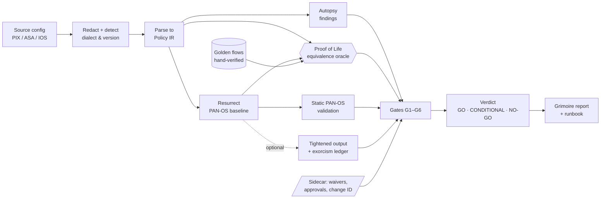

# 🕯️ NECROMANCER

**Raise dead firewall configs as zero-trust policy, and prove they came back the same.**

[](https://github.com/natrajexplore/necromancer/actions/workflows/ci.yml)
[](LICENSE)


*Kiroween 2026 · Category: **Resurrection** · Built spec-first with Kiro*

> **Status:** the specs, steering, hooks, agents, samples and CI are in place. The application itself is being generated in Kiro
> during the submission period (Oct 30 – Dec 4, 2026). Features below describe the specified behaviour. See [Roadmap](#roadmap).

---

## Contents
- [The problem](#the-problem)
- [The ritual](#the-ritual)
- [How it works](#how-it-works)
- [Migration semantics it gets right](#migration-semantics-it-gets-right)
- [Proof, not promises](#proof-not-promises)
- [Readiness verdict and governance](#readiness-verdict-and-governance)
- [Supported sources and scope](#supported-sources-and-scope)
- [Built with Kiro](#built-with-kiro)
- [Quality gates (CI)](#quality-gates-ci)
- [Repository map](#repository-map)
- [Quick start](#quick-start)
- [Roadmap](#roadmap)
- [Security and data notice](#security-and-data-notice)
- [Disclosure](#disclosure) · [License](#license)

---

## The problem
Every enterprise has a graveyard: Cisco PIX, ASA 8.x and IOS 12 devices that went end-of-life years ago but still guard
production. They stay because nobody can **prove** that a rewrite of thousands of rules behaves the same. Manual
migrations quietly break things: a security-level permit nobody wrote down, an ACL that referenced a NATed address, an
ICMP rule widened to "ping", an IPv6 line that simply vanished.

NECROMANCER turns that leap of faith into evidence a change advisory board can sign.

## The ritual

| Ritual | What happens |
|---|---|
| ⚰️ **Exhume** | Parse PIX 6.x / ASA 7.x–9.x / IOS 12 ACLs into a vendor-neutral IR. Secrets are redacted, and every input line is classified, so nothing disappears silently |
| 🔪 **Autopsy** | Find ghost rules: shadowed, redundant, overly broad, insecure services, unused objects, insecure management, unfiltered interfaces |
| 🧟 **Resurrect** | Emit a like-for-like PAN-OS candidate config. Optional zero-trust tightening is a **separate** output, tracked in an exorcism ledger |
| 💓 **Proof of Life** | A property-based oracle (Hypothesis) checks old vs new decisions over thousands of boundary-biased flows, plus hand-verified golden flows, or shows the shrunk counterexample |
| 🚦 **Verdict** | Validation gates G1–G6 give **GO / CONDITIONAL / NO-GO**, with the blocking reasons first |
| 📖 **Grimoire** | A deterministic, audit-stamped migration report and cutover/rollback runbook for your change record |

## How it works



The same engine is exposed three ways: a CLI (`necro`), an HTTP API (FastAPI, `/v1/...`) and an MCP server
(`exhume`, `autopsy`, `resurrect`, `prove`, `gate`) so Kiro and other agents can call it directly.

## Migration semantics it gets right
The classic ASA/IOS → PAN-OS traps are pinned down in [`policy-semantics.md`](.kiro/steering/policy-semantics.md) and
tested with hand-verified vectors in [`samples/golden-flows/`](samples/golden-flows):

| Trap | What NECROMANCER does |
|---|---|
| ASA/PIX interface without an ACL | Models the security-level implicit permit (higher → lower only), the same-security restriction and PIX `nat-control` |
| ASA 9.x global ACL | Interface ACL → global ACL → implicit deny. Once a global ACL exists, the security-level permit is gone everywhere |
| Pre-8.3 vs 8.3+ ACL addresses | Pre-8.3 ACLs use the mapped address, 8.3+ the real one. Both map to PAN-OS **pre-NAT IP + post-NAT zone** |
| Destination zones | Derived from the route table (longest prefix), splitting a rule per zone when needed |
| IOS `established` | Can't be carried over (PAN-OS is stateful), so it's recorded in the ledger instead of being approximated silently |
| IOS interface without an ACL | Permits everything, and is flagged as an unfiltered interface |
| To-the-box traffic | Becomes a PAN-OS management profile, not a security rule |
| Port names | Keyed by protocol: 514/tcp (`rsh`) ≠ 514/udp (`syslog`), Cisco `radius` = 1645 |
| ICMP types | Exact types via custom applications. Never silently widened to the `ping` App-ID |
| IPv6, FQDN objects, transparent mode, ... | Become security-relevant unparsed lines that **block** the verdict until a named person waives them |

**Worked example** (golden flow `A98-01`, from [`asa-9.8-dc.cfg`](samples/dead-configs/asa-9.8-dc.cfg)):

| | ASA 9.8 source | PAN-OS target (expected) |
|---|---|---|
| Rule | `OUTSIDE_IN#1`: `permit object-group WEB-SVCS any4 object-group DMZ-SERVERS` | Translated rule, `from outside` |
| Destination | Real IP `10.60.0.10` (object NAT `static 203.0.113.10`) | **Pre-NAT** IP `203.0.113.10` |
| Zone | Interface `dmz` | **Post-NAT** zone `dmz` |
| Decision for `tcp 192.0.2.44:40000 → :443` | permit | permit ✅ |

Writing the real IP in the PAN-OS rule is the most common ASA → Palo Alto migration bug. The oracle and the golden flow
both catch it.

## Proof, not promises
- **Equivalence oracle.** Hypothesis generates boundary-biased flows (port edges, mask edges, every ICMP type, named
  protocols) per interface context and compares the source decision with the target decision. Budgets: `dev` 500,
  `ci` 5,000, `demo` 10,000 examples per context.
- **Shrunk counterexamples.** When the policies diverge, you get the single smallest packet that proves it, with both
  decisions and zones: *the packet that refused to rest*.
- **Golden flows.** 55 expected decisions, worked out by hand from vendor semantics and kept independent of the
  evaluator, so the oracle can't grade its own homework.
- **Mutation sanity suite.** 10 deliberate emitter bugs (swapped `lt`/`gt`, untranslated 8.3+ NAT destination, ICMP
  widened to `ping`, ...) must each be caught.
- **Properties P1–P14** are listed in [`pbt-playbook.md`](.kiro/steering/pbt-playbook.md).

## Readiness verdict and governance

| Gate | Blocks GO when |
|---|---|
| **G1** Input integrity | Dialect confidence < 0.9, unsupported OS version, or not routed single-context |
| **G2** Coverage | Any security-relevant line is unparsed or out-of-scope and not waived |
| **G3** Target static validation | Invalid or duplicate names, unresolved references, empty groups, missing zones or final deny, unledgered `any`→`any` allow |
| **G4** Equivalence | Proof below the `ci` budget, any divergence outside the ledger, or any golden-flow failure |
| **G5** Ledger review | Any ledger entry still `pending` |
| **G6** Risk findings | Any open critical finding without an accepted-risk record |

- **GO**: all gates pass. **CONDITIONAL**: passes only through valid, named, unexpired waivers (or the four-eyes rule
  isn't met). **NO-GO**: anything else.
- The 12 mandatory migration phases (scope → baseline → hygiene → like-for-like translation → validation → peer
  review/CAB → pre-checks → cutover → hypercare → rollback → optimization → decommission) are defined in
  [`migration-governance.md`](.kiro/steering/migration-governance.md).
- The runbook generates PAN-OS `test security-policy-match` and ASA `packet-tracer` verification commands with the
  expected result for each.
- Evidence is mapped to PCI DSS v4.0, NIST SP 800-41/800-53, ISO/IEC 27001:2022 and CIS Controls v8 as **"supports
  evidence for"**. NECROMANCER never claims compliance and never says "safe to deploy".

## Supported sources and scope

| Source | Version | Phase |
|---|---|---|
| Cisco PIX | 6.x | P1 (hackathon MVP) |
| Cisco ASA | 7.x – 8.2 (pre-8.3 NAT) | P1 |
| Cisco ASA | 8.3 – 9.x (object NAT, global ACL) | P2 (enterprise) |
| Cisco IOS | 12.x extended/standard ACLs | P1 |
| **Target** | Palo Alto Networks PAN-OS (candidate `set` config) | P1; NAT rule emission in P2 |

**Out of scope for policy migration** (detected and listed, never silently dropped): VPN, dynamic routing, AAA, IPS,
QoS, multiple-context mode, transparent mode, identity firewall and TrustSec.

## Built with Kiro

| Kiro feature | How NECROMANCER uses it |
|---|---|
| **Specs** | 3 specs ([`necro-engine`](.kiro/specs/necro-engine), [`migration-governance`](.kiro/specs/migration-governance), [`graveyard-ui`](.kiro/specs/graveyard-ui)), 119 EARS acceptance criteria, each traced to a task |
| **Steering** | 8 docs across 3 inclusion modes: always (product, tech, structure, security), fileMatch (policy-semantics, migration-governance, haunted-ui), manual (pbt-playbook) |
| **Hooks** | 6 v1 hooks: run the proof on save, guard seeded ghosts and golden flows, re-check gate rules, block secrets, enforce spec traceability, keep a build journal |
| **Custom agents** | 5 scoped specialists: `ghoul-parser`, `autopsy-surgeon`, `necromancer`, `oracle`, `gatekeeper` |
| **MCP** | The project's own MCP server (`exhume`, `autopsy`, `resurrect`, `prove`, `gate`) plus `fetch` |
| **Kiro Crew** | A multi-agent "Séance" workflow with approval gates. See [`crew/README.md`](crew/README.md) |

## Quality gates (CI)
[`.github/workflows/ci.yml`](.github/workflows/ci.yml) runs on every push and pull request:

| Job | Checks |
|---|---|
| Specs, hooks and samples | `.kiro` JSON validity, `.kiro` never git-ignored, spec traceability, sample annotations, synthetic-only IPs, golden-flow schema ([`check_repo.py`](.github/scripts/check_repo.py)) |
| Backend | `ruff`, `mypy --strict`, `pytest` with ≥ 90% coverage, PBT at the `ci` profile, golden flows, `pip-audit` |
| Frontend | `npm ci`, build, tests, `npm audit --audit-level=high` |

The backend and frontend jobs switch on automatically once Kiro generates `backend/pyproject.toml` and
`frontend/package-lock.json`.

## Repository map
```
.kiro/specs/             necro-engine · migration-governance · graveyard-ui (requirements → design → tasks)
.kiro/steering/          product, tech, structure, security (always) · policy-semantics, migration-governance, haunted-ui (fileMatch) · pbt-playbook (manual)
.kiro/hooks/             proof-of-life, ghost-rule-guard, readiness-gate-guard, secret-exorcist, spec-traceability, kiro-journal-on-stop
.kiro/agents/            ghoul-parser, autopsy-surgeon, necromancer, oracle, gatekeeper
.kiro/settings/          mcp.json (necromancer MCP server + fetch)
.github/                 CI workflow + repo-integrity checks
samples/dead-configs/    synthetic PIX 6.3 / ASA 8.2 / ASA 9.8 / IOS 12.4 configs with seeded "! GHOST:" rules
samples/broken-configs/  negative fixtures (cycles, undefined groups, unsupported constructs, out-of-scope modes)
samples/golden-flows/    55 hand-verified expected decisions (TOML), independent of the evaluator
crew/                    Kiro Crew "Séance" workflow
docs/                    rules analysis, idea selection, build plan, Kiro write-up, video script, Devpost draft
```

## Quick start
*Available once the application is generated. Requires Python 3.12 + [`uv`](https://docs.astral.sh/uv/) and Node 22.*

```bash
# Backend: tests, including the property-based proof
cd backend && uv sync && uv run pytest -q

# Prove a sample config and get a readiness verdict
uv run necro prove ../samples/dead-configs/pix-2006-hq.cfg --profile demo
uv run necro gate  ../samples/dead-configs/pix-2006-hq.cfg --sidecar approvals.toml   # exit 0 = GO/CONDITIONAL, 1 = NO-GO

# Haunted web UI
npm --prefix frontend install && npm --prefix frontend run dev
```

Check the specs and samples today, with only Python 3.11+:
```bash
python -I .github/scripts/check_repo.py
```

## Roadmap
- [x] Specs, steering, hooks, agents and MCP configuration
- [x] Synthetic samples, negative fixtures and 55 golden flows
- [x] CI with repo-integrity checks
- [ ] **necro-engine** Phase 1: IR, PIX/ASA ≤ 8.2/IOS parsers, evaluator, autopsy, PAN-OS emitter, Proof of Life, MCP server
- [ ] **migration-governance**: gates G1–G6, verdict, audit header, Grimoire, runbook, `necro gate`
- [ ] **graveyard-ui**: graveyard, autopsy, resurrection, proof viewer, verdict + Grimoire
- [ ] Hosted demo (S3 + CloudFront, FastAPI on Lambda)
- [ ] Phase 2: ASA 8.3+ object NAT, PAN-OS NAT rule emission, hit-count import, PDF/CSV export

The day-by-day plan is in [`docs/03-build-plan.md`](docs/03-build-plan.md).

## Security and data notice
- All sample configs are **synthetic**: RFC 5737 / RFC 1918 addresses and fake secrets. CI fails if a non-synthetic
  address appears in `samples/`.
- Secrets (enable/user passwords, PSKs, SNMP communities, TACACS/RADIUS keys) are redacted before anything else runs.
  The report recommends rotating each one, counted by type and never shown.
- The hosted demo processes uploads in memory and stores nothing.
- NECROMANCER **never connects to or pushes configuration to any device**. It produces a candidate config and evidence
  for human review.
- Vendor names are used only to describe compatibility. This project isn't affiliated with or endorsed by any vendor.

## Disclosure
Planning documents and the initial spec drafts were prepared with Claude before implementation began, and the CI
workflow and repo-integrity script were written outside Kiro. All application code is generated and iterated in Kiro.
Third-party libraries will be listed in `backend/pyproject.toml` and `frontend/package.json`.

## License
MIT. See [LICENSE](LICENSE).
